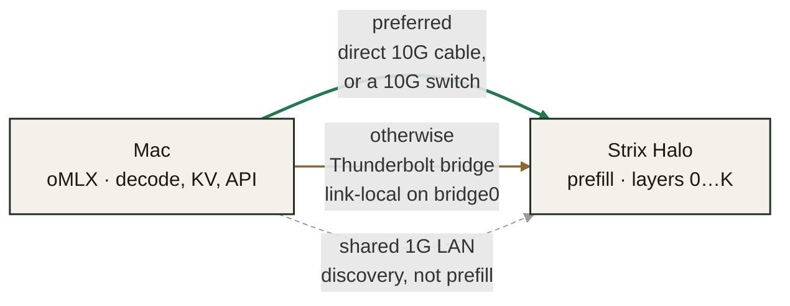

# Hardware and cable

One Mac running oMLX and one Strix Halo running this helper. The Mac holds the weights, the KV cache, and decode. For prompts of 2,048 tokens and up, the Halo prefills the first K layers of each chunk and returns the hidden state plus the cache rows; the Mac runs the layers that remain. Shorter prompts, and prompts with images, stay on the Mac.

## Machines

- **Mac.** Apple silicon with enough memory for the model; the results in the README use an M3 Ultra with 512 GB. Run oMLX from the [audiohacking/omlx](https://github.com/audiohacking/omlx) fork when the cable is Thunderbolt (see below). Stock oMLX is fine on 10G.
- **Strix Halo.** Ryzen AI Max+ 395 with the Radeon 8060S (gfx1151), for example the Minisforum MS-S1 MAX. Keep the BIOS power mode on **Balanced**: Performance raises the power cap, and under sustained prefill the GPU can reach its thermal limit and slow down.

## The cable

Prefill data crosses one cable. A direct 10G link, or both machines on a 10G switch, is the simplest choice: it reports a media speed, and stock oMLX selects it. A Thunderbolt bridge works as well and is what the README results use.

Over Thunderbolt, the Halo's interface negotiates 80 Gbit/s and has no DHCP lease. The Mac reaches it at that interface's IPv6 link-local address, scoped to `bridge0`. Stock oMLX only ranks interfaces that report a numeric media speed, so it would stay on the shared gigabit network; the fork ranks the bridge by the 80 Gbit/s the Halo reports. While the bridge answers, the fork prefers it over a 10G port, so leave the bridge down when 10G is the path you want.

After Pair, Check shows the cable in use: **10000 Mbit/s** on 10G, **80000 Mbit/s** on the bridge. **1000 Mbit/s** means the traffic is on the gigabit port.

For installing, pairing, recommended settings and troubleshooting, see the [README](README.md#quick-start).
