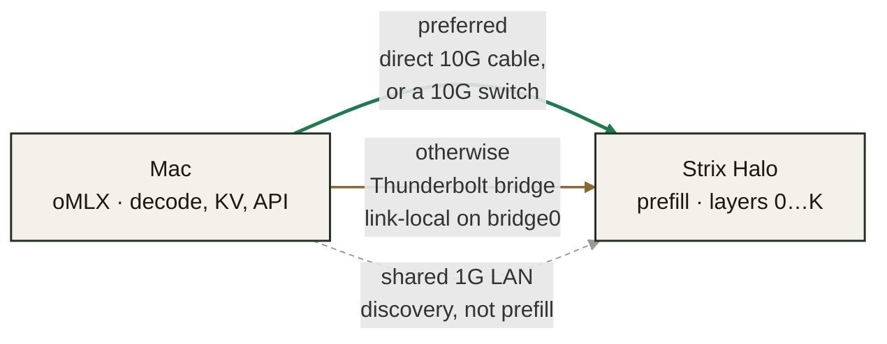

# Setup

One Mac running oMLX and one Strix Halo running this helper. The Mac holds the weights, the KV cache, and decode. For prompts of 2,048 tokens and up, the Halo prefills the first K layers of each chunk and returns the hidden state plus the cache rows; the Mac runs the layers that remain. Shorter prompts, and prompts with images, stay on the Mac.

## Machines

- **Mac.** Apple silicon with enough memory for the model; the results in the README use an M3 Ultra with 512 GB. Run oMLX from the [audiohacking/omlx](https://github.com/audiohacking/omlx) fork when the cable is Thunderbolt (see below). Stock oMLX is fine on 10G.
- **Strix Halo.** Ryzen AI Max+ 395 with the Radeon 8060S (gfx1151), for example the Minisforum MS-S1 MAX. Keep the BIOS power mode on **Balanced**: Performance raises the power cap, and under sustained prefill the GPU can reach its thermal limit and slow down.

## The cable

Prefill data crosses one cable. A direct 10G link, or both machines on a 10G switch, is the simplest choice: it reports a media speed, and stock oMLX selects it. A Thunderbolt bridge works as well and is what the README results use.



Over Thunderbolt, the Halo's interface negotiates 80 Gbit/s and has no DHCP lease. The Mac reaches it at that interface's IPv6 link-local address, scoped to `bridge0`. Stock oMLX only ranks interfaces that report a numeric media speed, so it would stay on the shared gigabit network; the fork ranks the bridge by the 80 Gbit/s the Halo reports. While the bridge answers, the fork prefers it over a 10G port, so leave the bridge down when 10G is the path you want.

After Pair, Check shows the cable in use: **10000 Mbit/s** on 10G, **80000 Mbit/s** on the bridge. **1000 Mbit/s** means the traffic is on the gigabit port.

The helper reports version 0.1.11; oMLX expects 0.1.7 or newer.

## Mac

oMLX is not part of this repo. To install the fork:

```bash
git clone https://github.com/audiohacking/omlx.git
cd omlx
make install
.venv/bin/omlx serve --host 0.0.0.0 --port 8000
```

Place the model where that server loads models. Both machines must use the same checkpoint.

Recommended settings for `Qwen3.8-27B-oQ4e`:

- Prefill helper: the paired Halo, layer count on Auto.
- MTP on, VLM MTP off.
- Native bf16 KV. Float16 activations, TurboQuant, affine KV, and INT8 activation prefill off.
- ANE prefill on: sequence 2048, fraction 0.53, dual ANE, GDN fraction 0.5, GDN layers capped at 48, tail padding from 512 tokens. ANE and the helper work independently.
- Speculative prefill and DFlash off.

Recommended settings for `Qwen3.8-Flash-Next-oQ4e-mtp`:

- Prefill helper: the paired Halo, layer count **20 or 21** of 48. Auto works too and lands close to that.
- MTP on. Other settings at their defaults.

Decode always stays on the Mac.

## Halo

With Docker:

```bash
docker run -d --name omlx-helper --restart unless-stopped \
  --device=/dev/kfd --device=/dev/dri \
  --group-add video --group-add render \
  --network host --ipc host \
  -v omlx-helper:/data \
  ghcr.io/audiohacking/omlx-strix-helper
docker logs -f omlx-helper
```

The image contains the helper only: ROCm SDK `10.3.0a20261120`, MLX `fc344c9` with the gfx1151 ROCm overlay, and the attention library already compiled. The volume holds the helper's state. Pass `--name halo` after the image name to set the name shown in the Cluster tab.

The helper speaks the CUDA helper protocol: discovery on `_omlx._tcp.local.`, ports 8850 (http), 8851 (control), and 8852 (data).

To run from source instead, install the MLX build above with the two patches in `patches/` (`rocm-cuda-kernel-hip.patch` forwards `mx.fast.cuda_kernel` to the HIP JIT; `nvfp4-gfx1151-hipcc.patch` fixes a hipcc 7.18 build stop on gfx1151), then build the attention library:

```bash
hipcc -O3 -shared -fPIC --offload-arch=gfx1151 -std=c++20 \
  omlx_cuda_helper/families/qwen3_5/gufo_attention.hip \
  -o omlx_cuda_helper/families/qwen3_5/libgufo_attn.so
```

Install and serve, with `rocm-sdk` on `PATH` and `ROCM_PATH` set to that SDK:

```bash
python3 -m venv .venv
.venv/bin/pip install -e .
export PATH="$HOME/rocm-env/bin:$PATH"
export ROCM_PATH="$(rocm-sdk path --root)"
export LD_LIBRARY_PATH="$ROCM_PATH/lib:$HOME/rocm-env/lib${LD_LIBRARY_PATH:+:$LD_LIBRARY_PATH}"
omlx-strixworker serve --name halo
```

State lives in `~/.omlx-cuda-helper`. Pair from the Mac: Cluster, Find devices, Pair, Check. Pass `--pair` only to join an oMLX that has not paired this helper yet.

## Troubleshooting

- **Prefill close to the Mac's own speed.** Check that the cable reads 10000 or 80000 Mbit/s in Check. A gigabit path, or a helper that dropped out, looks like this.
- **First prompt after an update is slower.** With the layer count on Auto, oMLX first re-measures both sides; later prompts settle.
- **Speed drops over long sessions.** Both machines lower their GPU clocks under sustained load. After ten minutes or more of continuous long prompts, the Mac's own prefill can run about a fifth slower until it has cooled for a few minutes; Balanced firmware keeps the Halo's drop small. Compare speeds with both machines cool.
- **Per-chunk timing.** Start the helper with `STRIX_CHUNK_LOG=1` to log, for each chunk, how long the Halo waited for the Mac and how long it computed. A Halo that never waits is the slower side; a larger layer count then makes things slower, a smaller one faster.
