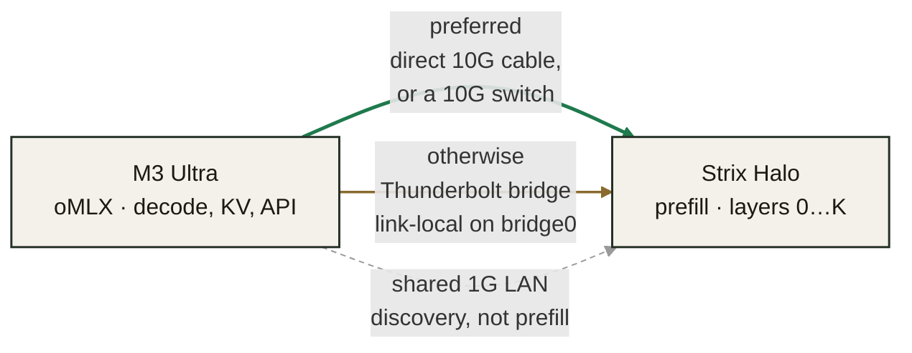

# Demo

One M3 Ultra and one Strix Halo. The Mac runs oMLX, holds the weights, the KV cache, and decode. From 2,048 tokens up, the Halo prefills layers `[0, K)` and returns the hidden state plus the cache rows. The Mac runs the layers that remain. Prompts shorter than that, and any prompt with an image, stay on the Mac.

The numbers in the README are this setup. Qwen3.8 27B oQ4e, 65,536-token prompt, 128 generated tokens, MTP on: **710 prefill tok/s, 67 decode tok/s**. The same prompt on the gigabit port is not this demo.

## Machines

- **Mac.** M3 Ultra, 512 GB. oMLX from the [audiohacking/omlx](https://github.com/audiohacking/omlx) fork, not the upstream app, the Homebrew tap, or a release dmg. The fork is jundot/omlx plus the Thunderbolt bridge picker (`d19de537` on `main`).
- **Halo.** Minisforum MS-S1 MAX. Ryzen AI Max+ 395, Radeon 8060S, gfx1151, 40 CUs. BIOS power mode **Balanced**. Performance mode raises the power cap, the GPU hits the thermal limit, and the same 64K prompt comes back slower. Leave the firmware in Balanced. Clock sysfs is not part of the setup.

## The cable

Prefill crosses one cable. A direct 10G link, or both machines on a 10G switch, is the one to use when it exists. It reports a real media speed, stock oMLX will select it, and it can be faster than the bridge. The README row was measured on the Thunderbolt bridge because that was the fast cable on this desk.



The Halo's Thunderbolt interface negotiates 80 Gbit/s and has no DHCP lease. The Mac reaches it at that interface's IPv6 link-local address, scoped to `bridge0`. The member port is in the bridge and has no address of its own. `ifconfig` reports `media: autoselect` for the bridge, with no `1000baseT`-style speed.

Stock oMLX discovers the helper on the network both machines share and stays there. It drops 169.254 addresses, and it only ranks interfaces that report a numeric media speed, so a bridge never wins against gigabit. A 10G port does report a speed, which is why that path needs no fork. The fork ranks the bridge by the 80 Gbit/s the Halo reports. While the bridge answers, that rank beats a 10G NIC, so leave the bridge down when the 10G path is the one you want.

After Pair, Check shows the cable actually in use. On 10G that is the 10G address at **10000 Mbit/s**. On the bridge it is the link-local address at **80000 Mbit/s**. A pass on a 1000 Mbit/s Ethernet address is the wrong cable. Unscoped 169.254 traffic follows whichever interface already owns that route; do not send the cable's traffic out the gigabit port.

This helper reports version 0.1.6. The fork's check expects 0.1.7 and warns. The warning does not stop prefill. The family row is `qwen3_5`.

## Mac

Install from source, the same way as upstream oMLX, against the fork:

```bash
git clone https://github.com/audiohacking/omlx.git
cd omlx
make install
.venv/bin/omlx serve --host 0.0.0.0 --port 8000
```

Place the model where that server already loads models. The measured checkpoint is `Qwen3.8-27B-oQ4e`.

On that model:

- Prefill helper: the paired Halo. Layer count stays on Auto.
- MTP on. VLM MTP off.
- Native bf16 KV. Float16 activations off. TurboQuant off. Affine KV off. INT8 activation prefill off. Those four were measured and lost prefill, decode, or both.
- ANE prefill on. Sequence 2048, fraction 0.53, dual ANE, GDN fraction 0.5, GDN layers capped at 48, tail padding from 512 tokens. ANE and the helper are independent: the Halo never runs the ANE graph.
- Speculative prefill and DFlash off.

Decode stays on the Mac either way. The helper never decodes.

## Halo

The zero-friction install is the container. A release of this repo builds `ghcr.io/audiohacking/omlx-strix-helper` for gfx1151 and pushes it. On the Halo:

```bash
docker run -d --name omlx-helper --restart unless-stopped \
  --device=/dev/kfd --device=/dev/dri \
  --group-add video --group-add render \
  --network host --ipc host \
  -v omlx-helper:/data \
  ghcr.io/audiohacking/omlx-strix-helper
docker logs -f omlx-helper
```

The image is the same helper as the source build below: ROCm SDK `10.3.0a20261120`, MLX `fc344c9` with the gfx1151 ROCm overlay, and `libgufo_attn.so` already compiled. The volume is the helper's state. Pass `--name halo` after the image name to set the Cluster tab name.

The worker speaks the CUDA helper protocol on purpose: `control` is `agent`, `backends` is `["cuda"]`, discovery is `_omlx._tcp.local.`, ports are 8850 (http), 8851 (control), and 8852 (data). The import package is `omlx_cuda_helper`. The only served family is `qwen3_5`.

The measured stack is MLX `fc344c9` with the mlxcel ROCm overlay and ROCm `10.3.0a20261120`. Two patches in this repo belong on that build:

- `patches/rocm-cuda-kernel-hip.patch` forwards `mx.fast.cuda_kernel` to the HIP JIT, which is what runs the gated-delta recurrence in one launch.
- `patches/nvfp4-gfx1151-hipcc.patch` gets hipcc 7.18 past `nvfp4_gather_expert_batched_kernel` on gfx1151. This checkpoint never takes that kernel.

Build the attention library on the Halo. It is gitignored.

```bash
hipcc -O3 -shared -fPIC --offload-arch=gfx1151 -std=c++20 \
  omlx_cuda_helper/families/qwen3_5/gufo_attention.hip \
  -o omlx_cuda_helper/families/qwen3_5/libgufo_attn.so
```

Dense linears stay `x @ weight.T` through hipBLASLt. Attention is Gufo's packed WMMA kernel (`WmmaCausalAttention<32,16,true>`) once a chunk has at least 1,024 query rows.

Install and serve from this repo, with `rocm-sdk` on `PATH` and `ROCM_PATH` set to that SDK:

```bash
python3 -m venv .venv
.venv/bin/pip install -e .
export PATH="$HOME/rocm-env/bin:$PATH"
export ROCM_PATH="$(rocm-sdk path --root)"
export LD_LIBRARY_PATH="$ROCM_PATH/lib:$HOME/rocm-env/lib${LD_LIBRARY_PATH:+:$LD_LIBRARY_PATH}"
omlx-strixworker serve --name halo
```

State lives in `~/.omlx-cuda-helper`. Pass `--pair` only for a helper that is not paired yet. A paired helper is joined from the Mac: Cluster, Find devices, Pair, Check.

## What the 710 run is

Balanced firmware, the bridge at 80 Gbit/s, native bf16, ANE and MTP on, hipBLASLt for the linears, one packed attention launch per full-attention layer. Auto picks how the 64 layers split. The link is tens of milliseconds. The Mac's remaining layers are the long pole when the bridge is the cable.

A repeat of the 64K prompt on that bridge lands on the README row. A 10G cable or a 10G switch is the preferred substitute, and it can come out ahead of the bridge; there is no 10G row in the table yet. Treat a result near 300 tok/s as the gigabit port, or as the helper having been dropped, and check the cable before changing a kernel.
