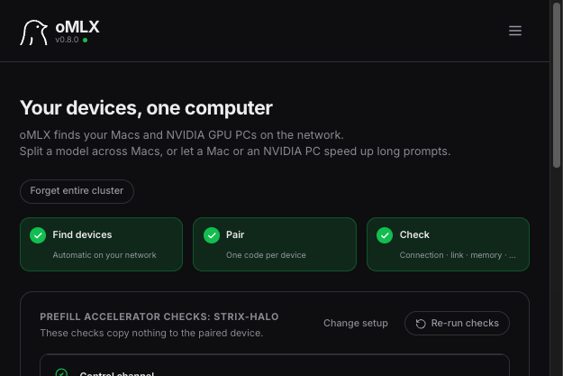

# omlx-strixworker

Prefill helper for an AMD Strix Halo machine. oMLX drives it as the CUDA helper: same discovery, pairing, control channel, and data framing. This repo is the only place that code is committed. The oMLX checkout holds it as `apps/omlx-strixworker` while it is being tested.

The import package is `omlx_cuda_helper` on purpose. The protocol tests in the oMLX tree import that name, and this process has to answer them.

## Paired with oMLX

oMLX 0.8.0 discovers this process the same way it discovers the CUDA helper. On a Strix Halo named `strix-halo`, Find devices, Pair, and Check all pass:



## Protocol tests

From the oMLX checkout, so this package is imported instead of `apps/omlx-cuda-helper`:

```bash
.venv/bin/pytest apps/omlx-cuda-helper/tests/test_protocol.py \
  apps/omlx-cuda-helper/tests/test_chain.py \
  -o 'pythonpath=apps/omlx-strixworker apps/omlx-cuda-helper/tests' -q
```

`test_qwen3_5.py` replays the oMLX contract fixture through this package's stage. On a Mac that is the Metal path, the same one the CUDA helper uses when CUDA is absent. On the Halo it is the ROCm path. The CUDA-only oQh checks stay skipped until that kernel is ported.

The Halo build is MLX `fc344c9` with the mlxcel ROCm overlay, ROCm `10.3.0a20261120`, and `patches/nvfp4-gfx1151-hipcc.patch`. hipcc 7.18 aborts while compiling `nvfp4_gather_expert_batched_kernel` for gfx1151, so that launch falls through to `nvfp4_qmv`. Qwen3.5 affine does not use it. With that patch the same contract test passed on the Radeon 8060S: 10 passed, 5 skipped.

`patches/rocm-cuda-kernel-hip.patch` makes `mx.fast.cuda_kernel` call the HIP JIT. The Qwen3.5 stage uses that to run gated delta as one GPU launch per layer. Without it the ROCm primitive expands the recurrence into one graph per token and the Radeon sits idle.

Long-context attention is `gufo_attention.hip`, adapted from Gufo's WMMA kernel (MIT) for the Qwen 24/4/256 shape. Build it on the Halo; the shared library stays on that machine:

```bash
hipcc -O3 -shared -fPIC --offload-arch=gfx1151 -std=c++20 \
  omlx_cuda_helper/families/qwen3_5/gufo_attention.hip \
  -o omlx_cuda_helper/families/qwen3_5/libgufo_attn.so
```

```bash
.venv/bin/pytest apps/omlx-cuda-helper/tests/test_qwen3_5.py \
  apps/omlx-cuda-helper/tests/test_protocol.py \
  apps/omlx-cuda-helper/tests/test_chain.py \
  -o 'pythonpath=apps/omlx-strixworker apps/omlx-cuda-helper/tests' -q
```
